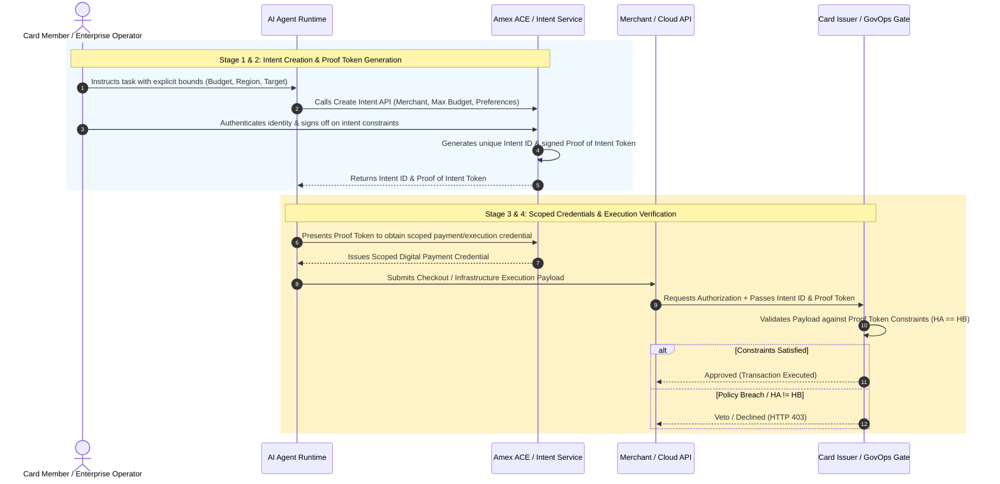
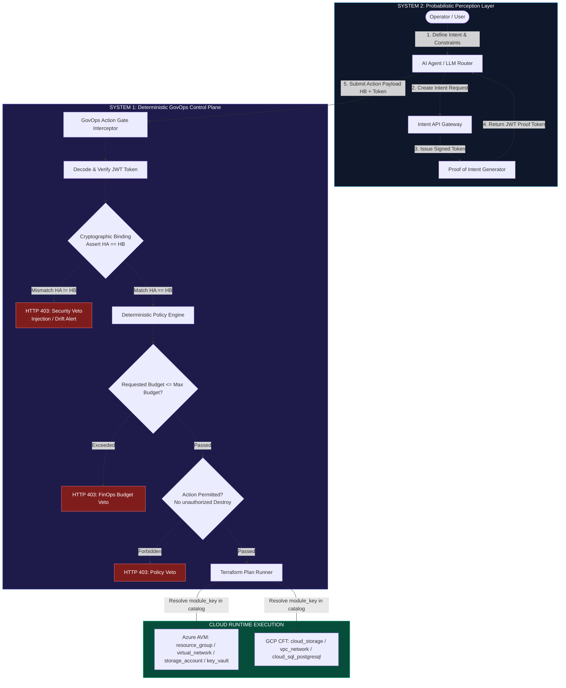
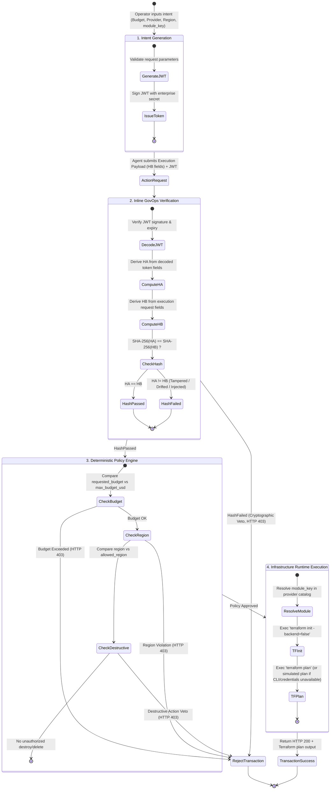

# Intent Intelligence: Adapting Amex's Agentic Commerce Framework for Enterprise FinOps and Multi-Cloud Governance

> This is the architecture write-up behind [govops-finops-action-gate](https://github.com/sehgalnamit/govops-finops-action-gate).
> For install/run instructions, see the main [README](../README.md).

As AI agents transition from passive conversational advisors to autonomous
enterprise actors, the software ecosystem faces a critical paradigm shift:
how do we grant AI systems execution authority without exposing core
infrastructure to runaway agentic loops, hallucinated state changes, or
prompt injection attacks?

The industry's initial response — relying on post-execution logging or
hoping probabilistic LLMs "behave themselves" — is fundamentally
insufficient for regulated enterprise environments.

American Express highlighted this exact challenge in its Intent
Intelligence Framework for Trusted Agentic Commerce, one of five core
services in the Amex Agentic Commerce Experiences (ACE) Developer Kit.
Amex's core architectural insight is simple yet profound: shift user
intent verification upstream, capturing and cryptographically scoping
authorized constraints before an agent executes a transaction.

By combining Amex's Intent Intelligence model with Cryptographic
Action-Binding (`H_A == H_B`) and deterministic policy execution gates,
this project adapts the framework to secure enterprise cloud
infrastructure, FinOps, and automated provisioning pipelines.

## 🧭 Framework Highlights

The concepts map directly from agentic commerce to agentic infrastructure:

| Intent Intelligence (Amex, payments) | GovOps FinOps Action Gate (this repo, infra) |
|---|---|
| User confirms intent: merchant, max spend, time limits | Agent declares intent: provider, target action/resource, `max_budget_usd`, `allowed_region`, expiry |
| Issuer authenticates the user and issues an **Intent ID** + **Proof of Intent Token** (JWT) | `POST /api/v1/intent/create` issues an `intent_id` + signed `proof_of_intent_token` (JWT) |
| Proof of Intent Token scopes a payment credential and expires on a set date | Proof-of-intent token scopes a Terraform action and expires via the JWT `exp` claim |
| Durable guardrails constrain agent action at execution, to limit disputes/fraud | `POST /api/v1/action/execute` re-verifies the token, enforces `H_A == H_B` action-binding, then applies budget/region/destructive-action policy guardrails before touching infrastructure |

## 1. The Core Problem: The Autonomous Execution Gap

Standard agentic workflows suffer from an architectural flaw: the
probabilistic reasoning layer is directly coupled to the execution runtime.

When an agent is allowed to reason, construct payloads, and directly invoke
tools or cloud endpoints (e.g., Terraform, GCP APIs, Azure Resource
Manager), any prompt drift, model failure, or injection attack leads to
immediate, unvetted state mutations. In consumer commerce, this manifests
as unauthorized purchases. In enterprise FinOps, it manifests as
unauthorized infrastructure scaling, deleted production databases, or
regional compliance breaches.

## 2. Amex Intent Intelligence: The 4-Stage Control Pattern

American Express addresses this by introducing a mandatory Intent Phase
that precedes the Execution Phase:

1. **Create & Confirm Intent (Create Intent API):** Captures explicit user
   instructions and boundary constraints — maximum budget ceiling, allowed
   merchant/provider, and target action — before any transaction starts.
2. **Establish Proof of Intent:** Generates a unique Intent ID and a
   cryptographically signed Proof of Intent Token representing the user's
   explicit authorization payload (`H_A`).
3. **Scope Execution Credentials:** The token scopes the operational
   credentials used during checkout or execution, ensuring downstream
   systems refuse actions that breach authorized parameters.
4. **Apply Intent Throughout Lifecycle:** The Intent ID and Proof Token act
   as inline controls across every subsequent hop, verifying that requested
   actions (`H_B`) match authorized intent (`H_A`) prior to state mutation.

## 3. Translating Amex Intent Intelligence to Multi-Cloud FinOps Governance

Applied to cloud orchestration — provisioning Azure Verified Modules (AVM)
or GCP Cloud Foundation Toolkit (CFT) modules — the Amex pattern becomes an
inline GovOps Action Gate sitting between an agent's probabilistic
reasoning (System 2) and deterministic infrastructure execution (System 1):

In plain terms, this is the same flow the main [README](../README.md#-architectural-flow)
summarizes as five steps: capture intent, issue a signed proof token
(`H_A`), verify `H_A == H_B` at execution, apply deterministic FinOps/GovOps
policy, and only then run `terraform plan`.

## 4. Complete End-to-End Execution Dataflow

This state diagram traces an incoming intent through JWT issuance,
cryptographic hash verification, deterministic policy validation, and
Terraform execution.

> Note: `RejectTransaction --> [*]` and `TransactionSuccess --> [*]` both
> legitimately converge on the diagram's single shared final state — a
> state machine has exactly one top-level final pseudostate, so every
> terminal path (approved or vetoed) funnels into it. That's expected UML
> `stateDiagram-v2` behavior, not a modeling error.

## 5. Comparative Matrix: Traditional Agents vs. Intent-Gated Architecture

| Architectural Feature | Traditional Agentic Architecture | Amex Intent Intelligence / GovOps Action Gate |
|---|---|---|
| Execution Authority | Delegated directly to probabilistic LLM | Reserved for deterministic control plane |
| Constraint Timing | Evaluated post-execution or in-prompt | Evaluated upstream, prior to state mutation |
| Security Mechanism | System prompts & LLM guardrails | Cryptographic Action-Binding (`H_A == H_B`) & JWT tokens |
| Audit Trail | Unstructured conversational logs | Immutable Intent ID linked to hashed execution payloads |
| Malicious Injection Resilience | Low (vulnerable to prompt manipulation) | High (payload modifications fail hash check `H_A != H_B`) |
| Regulatory & FinOps Alignment | Probabilistic / non-deterministic | Zero-variance compliance & bounded budget ceilings |

## Conclusion

The release of American Express's Intent Intelligence Framework marks an
industry milestone: it formalizes the shift from unconstrained model
autonomy to intent-bounded execution. Whether applied to consumer payment
rails or enterprise multi-cloud FinOps, the core engineering imperative
remains identical: never grant a probabilistic model direct execution
authority. By leveraging LLMs for perception and orchestration (System 2)
while enforcing state mutations through cryptographically bound,
deterministic gates (System 1), enterprises can safely deploy agentic
workflows at scale — maximizing speed while retaining absolute control over
security, budget, and compliance.

## Framework reference

- [Intent Intelligence: Building Trust in Agentic Commerce — American Express Technology](https://americanexpress.io/intent-intelligence-building-trust-in-agentic-commerce/)
- [American Express Publishes Intent Intelligence Framework for Trusted Agentic Commerce](https://www.americanexpress.com/en-us/newsroom/articles/innovation/intent-intelligence-framework-agentic-commerce.html)
- Reference implementation: [sehgalnamit/govops-finops-action-gate](https://github.com/sehgalnamit/govops-finops-action-gate)
